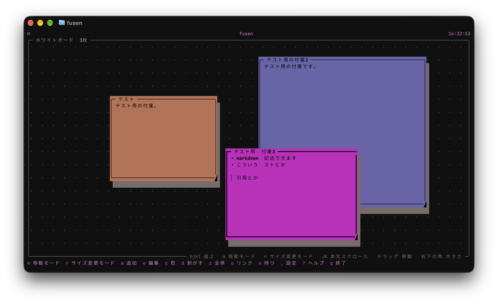
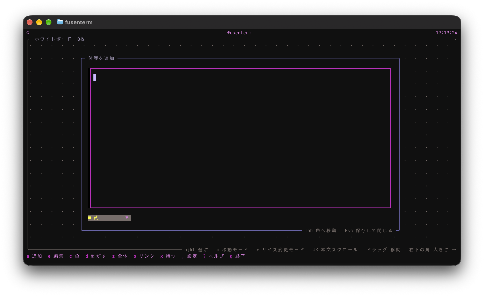
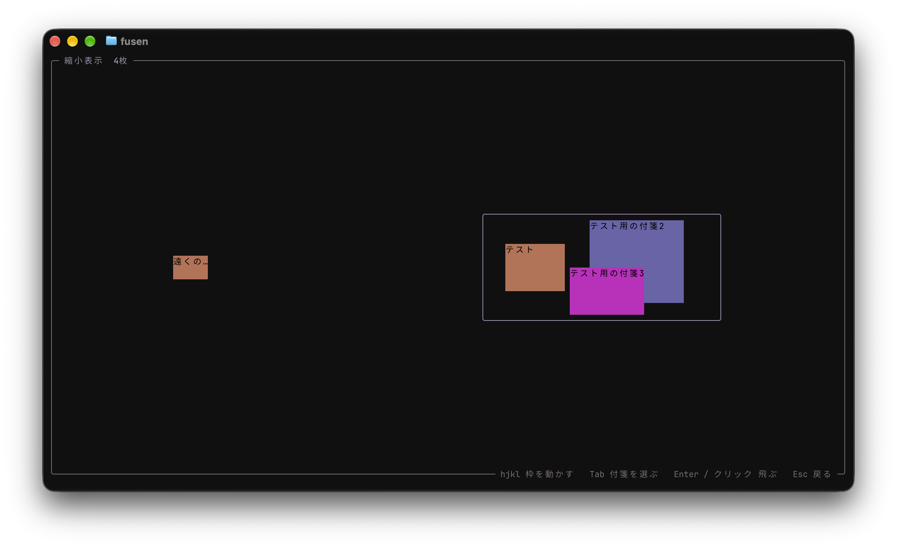
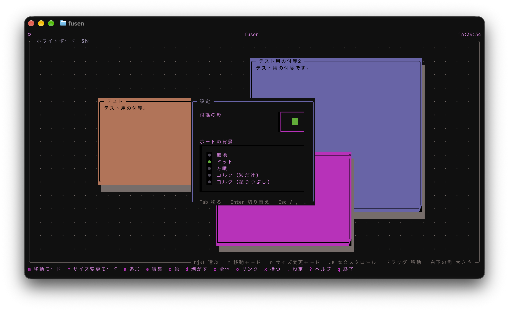

# fusenterm

ターミナルのホワイトボードに付箋を貼って、タスクやメモを管理するアプリ。
付箋は好きな位置・大きさ・色で貼れます。ホワイトボードは無限に広く、
縮小表示で全体を見渡せます。

<table>
  <tr>
    <td width="50%"></td>
    <td width="50%"></td>
  </tr>
  <tr>
    <td width="50%"></td>
    <td width="50%"></td>
  </tr>
</table>

## 使い方

```sh
# PyPI からインストール
pipx install fusenterm
fusenterm

# このリポジトリのソースから入れる
pipx install .
fusenterm

# 開発中はリポジトリの仮想環境から
./myenv/bin/fusenterm
```

## キー操作

| キー | 動作 |
|---|---|
| `a` | 付箋を追加 (今見ている範囲の中央付近。本文を書かずに閉じたら追加しない) |
| `e` / `Enter` | 選んでいる付箋の本文・色を編集 (`Esc` で保存して閉じる) |
| `c` | 色を 黄 → 桃 → 水 → 緑 → 青 → 赤 → 白 と切り替え |
| `←↓↑→` / `h j k l` | その向きの隣の付箋を選ぶ (選んだ付箋は一番手前に出る。移動モードでは付箋を1マス動かし、サイズ変更モードでは幅・高さを1マス変える) |
| `m` | 移動モードにする / 終える (`Esc` でも終わる) |
| `r` | サイズ変更モードにする / 終える (`Esc` でも終わる) |
| `Shift+↓↑` / `J K` | 付箋に収まらない本文を下 / 上へ1行スクロール |
| `Tab` / `Shift+Tab` | 次 / 前の付箋を選ぶ (重なり順で巡る) |
| `z` | 縮小表示 (ボード全体を見渡して、付箋や場所へ飛ぶ) |
| `o` | 選んでいる付箋に書かれたリンクの一覧 (`[文字](URL)` は文字と URL の両方を出す。`↑↓` / `j k` で選んで `Enter` かクリックでブラウザで開く。`Esc` / `o` で閉じる) |
| `x` | 選んでいる付箋を持つ (もう一度押すとやめる) |
| `p` | 持っている付箋を、今見ている範囲の真ん中に置く |
| `d` | 付箋を剥がす (確認画面で `y` 削除、`n` / `Esc` 取消) |
| `u` | 直前に剥がした付箋を戻す |
| `,` | 設定 (付箋の影・ボードの背景。`Esc` / `,` で閉じる) |
| `i` | このアプリについて (バージョン・保存先。`Esc` / `i` で閉じる) |
| `?` | ヘルプ (全キーの一覧。`Esc` で閉じる) |
| `q` | 終了 |

### マウス

| 操作 | 動作 |
|---|---|
| 付箋をクリック | 選んで一番手前に出す |
| 付箋をドラッグ | 移動 |
| 付箋の右下の角 (`◢`) をドラッグ | 大きさを変える |
| 選んでいる付箋の右上の角 (`×`) をクリック | 付箋を剥がす (`d` と同じく確認画面が出る) |
| 付箋をダブルクリック | 編集 |
| ボードの空いている所をドラッグ | ボードを動かす |
| ホイール / `Shift+ホイール` | ボードを上下 / 左右に動かす (本文が収まらない付箋の上では、先に本文をスクロール) |
| ボードの空いている所をダブルクリック | その位置に付箋を追加 |

### 付箋を選ぶ・動かす

`h j k l` (矢印キー) は、ふだんは隣の付箋を選ぶキーです。押した向きにある一番近い付箋
(真っ直ぐ先にあるものほど優先) を選びます。画面の外にある付箋も選べます。

付箋を動かすときは `m` で移動モードにします (枠が二重線になり「移動」と出る)。
移動モードの間は `h j k l` で付箋が1マスずつ動きます。`m` か `Esc` を押すか、
ほかの付箋を選ぶと終わります。

大きさを変えるときは `r` でサイズ変更モードにします (枠が二重線になり「サイズ変更」と出る)。
サイズ変更モードの間は `l` / `h` で幅が、`j` / `k` で高さが1マスずつ広がる / 縮みます。
終わり方は移動モードと同じです。移動モード中に `r` を押すとサイズ変更モードに切り替わります
(逆も同じ)。

### 収まらない本文を読む

本文が付箋に収まらないときは、下の枠の右に `▼` (下に続きがある) / `▲` (上に戻れる) が出ます。
`J` / `K` (`Shift+↓↑`) か、付箋の上でのホイールでスクロールできます。ホイールは本文の端まで
スクロールし切ると、ボードを動かすのに戻ります。スクロール位置は保存しません。

### ボードを動かす

ホワイトボードは上下左右どこまでも広がっていて、画面にはその一部が映っています。

- 付箋を選ぶ (`Tab` など) と、その付箋が見えるところまでボードが動きます。
  移動モードで付箋を画面の外へ動かしたときも付いていきます。
- マウスでは、空いている所のドラッグかホイールで動かせます。
- 遠くへ行くときや迷ったときは `z` の縮小表示を使います。

### 縮小表示 (`z`)

付箋と今見ている範囲 (枠) が全部収まるよう縮めて表示します。付箋は1行目だけを出します。

| キー・操作 | 動作 |
|---|---|
| `←↓↑→` / `h j k l` | 今見ている範囲の枠を動かす (周りの空いている所へも動かせる) |
| `Tab` / `Shift+Tab` | 付箋を選ぶ |
| `Enter` | 選んだ付箋へ飛ぶ (枠を動かした後なら枠の位置へ飛ぶ) |
| 付箋をクリック | その付箋へ飛ぶ |
| 空いている所をクリック | そこを真ん中にして飛ぶ |
| `Esc` / `z` | 何もせずに戻る |

見ている位置は保存しません。起動すると一番手前の付箋が見える位置から始まります。

### 付箋を遠くへ運ぶ (`x` → `p`)

1. 運びたい付箋を選んで `x` で持つ (枠が破線になり、ボードの題に「持っている: …」と出る)
2. `z` の縮小表示やマウスで、運びたい場所へ移る
3. `p` で、今見ている範囲の真ん中に置く (一番手前に出して選ぶ)

持っている間も付箋は元の場所に残っています (持ったまま終了しても失わない)。
別の付箋で `x` を押すと持ち替え、持っている付箋で押すとやめます。

## 設定 (`,`)

| 項目 | 内容 |
|---|---|
| 付箋の影 | 付箋の右下に影を付ける (既定はオン) |
| ボードの背景 | 無地 / ドット / 方眼 / コルク (粒だけ) / コルク (塗りつぶし) |

`Tab` で項目を移り、`Enter` / `Space` (かクリック) で切り替えます。変えるとすぐ後ろのボードに
反映して保存します。背景の模様はボードに描かれているので、ボードを動かすと一緒に動きます。

コルク (塗りつぶし) はボードを黄色で塗るので、黄の付箋は枠と影で見分けることになります。

## データ

変更するたびに自動で保存します。

- 保存先: `~/.local/share/fusen/notes.json` (`XDG_DATA_HOME` があればそちらに従う)
- 付箋のリストの順が重なり順 (後ろほど手前)
- `x` `y` はボード全体での位置 (マイナスもある)
- 読めないファイルは `notes.json.broken` に退避してから空で起動します
- 設定は同じ場所の `settings.json` (`{"shadow": true, "background": "plain"}`)。
  読めない場合は `settings.json.broken` に退避して既定の設定で起動します

```json
[
  {
    "id": "…",
    "text": "買い物\n- 牛乳\n- 卵",
    "x": 4,
    "y": 2,
    "width": 24,
    "height": 7,
    "color": "yellow"
  }
]
```

色は端末の ANSI パレットに追従します (`yellow` `magenta` `cyan` `green` `blue` `red` `white`)。

